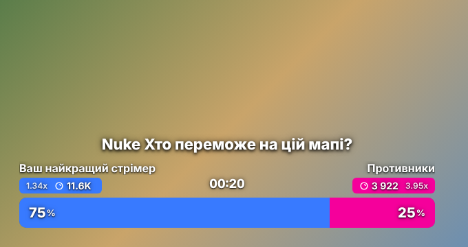
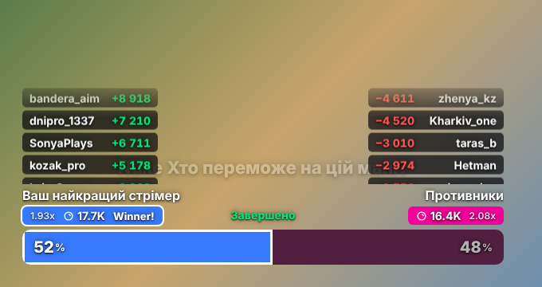

# Twitch Prediction Widget для OBS

Віджет для OBS Studio (Browser Source), який у реальному часі показує **прогнози за бали каналу Twitch** (Channel Points Predictions): ставки, відсотки, коефіцієнти, таймер, звук на старті, переможця і списки найбільших виграшів і програшів.

Це чистий HTML/CSS/JS без сервера, без збірки і без залежностей. Віджет підключається напряму до Twitch EventSub WebSocket.




## Можливості

- Віджет з'являється на початку прогнозу і грає звук: вбудований дзвіночок або свій mp3/wav.
- Бали, коефіцієнти (`1.94x`) і відсотки оновлюються в реальному часі **плавно**: смуга з'їжджає, числа докручуються.
- Таймер рахує час до закриття ставок.
- Коли ставки закриваються (за таймером **або вручну**), віджет ховається через N секунд.
- Коли прогноз розраховано, віджет з'являється знову. На плашці переможця з'являється `Winner!`, а над кожною стороною знизу вгору пливуть ніки зі сумами (`+49.8K` / `−4 880`).
- Після прокрутки списків віджет ховається.
- Скасований прогноз показує банер «скасовано».
- Підтримується 3–10 варіантів (компонування списком).
- Фон прозорий, текст із тінню, щоб читався поверх гри.
- Демо-режим `?demo=1` дозволяє перевірити вигляд без Twitch.

## Встановлення

1. Відкрийте `setup.html` у звичайному браузері.
2. Створіть застосунок на <https://dev.twitch.tv/console/apps/create>:
   - OAuth Redirect URL: `http://localhost`
   - Category: Broadcaster Suite, Client Type: **Public**
3. Вставте Client ID і натисніть «Увійти через Twitch».
4. Браузер відкриє `http://localhost/#access_token=…`. Сторінка покаже помилку, це нормально. Скопіюйте всю адресу і вставте її в `setup.html`.
5. Налаштуйте параметри і натисніть «Згенерувати посилання для OBS».
6. В OBS додайте джерело **Браузер**: зніміть галочку «Локальний файл», вставте URL, розмір **660×360** (для 3+ варіантів близько 660×460) і увімкніть **«Керувати аудіо через OBS»**.

> ⚠️ Посилання містить OAuth-токен. Не показуйте його і не комітьте. Токен живе близько 60 днів, після чого кроки 3–5 треба повторити.

## Параметри URL

| Параметр | За замовч. | Опис |
|---|---|---|
| `client_id` | — | Client ID Twitch-застосунку (**обовʼязково**) |
| `token` | — | OAuth-токен зі scope `channel:read:predictions` (**обовʼязково**) |
| `sound` | вбудований | URL або `file:///` шлях до звуку старту |
| `volume` | `0.7` | Гучність 0–1 |
| `lock_sound` | `0` | `1`: грати звук і при закритті ставок |
| `lock_hide` | `5` | Через скільки секунд сховати після закриття ставок (`0` = не ховати) |
| `hide` | `5` | Через скільки секунд сховати після прокрутки результатів (`0` = не ховати) |
| `rows` | `5` | Скільки ніків видно одночасно у списках |
| `speed` | `35` | Швидкість прокрутки списків, px/с |
| `results` | `1` | `0`: вимкнути списки переможців і програвших |
| `demo` | `0` | `1`: демо-режим без Twitch |

## Обмеження Twitch API

- У фінальній події Twitch передає лише **топ-10 учасників на кожен варіант** (за розміром ставки), а не всіх.
- Прогнози доступні тільки каналам з партнерством або афіліацією.

## Розробка

Контекст для розробки (архітектура, події, підводні камені) є в [CLAUDE.md](CLAUDE.md), стан проєкту і плани в [PROGRESS.md](PROGRESS.md).

```bash
pip install playwright && playwright install chromium
python tests/test_lifecycle.py      # автотест життєвого циклу
python tests/screenshots.py         # оновити скріншоти в docs/
```
