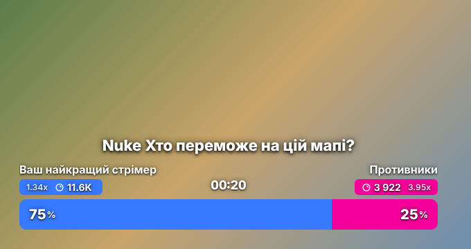
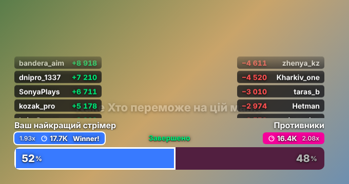

# StreamerTools

Набір віджетів для OBS Studio (Browser Source) і Twitch. Чистий HTML/CSS/JS без сервера, без збірки і без залежностей.

| Тулза | Адреса | Що робить |
|---|---|---|
| Налаштування | `/setup/` | Огляд тулз і вкладка з налаштуваннями для кожної: генерує посилання для OBS |
| Прогнози | `/widget/` | Прогнози за бали каналу в реальному часі: ставки, коефіцієнти, таймер, звук, переможець і списки виграшів/програшів |
| Таймер марафону | `/timer/` | «МАРАФОН GTA VI» + час з днями; старт, пауза, стоп і скидання командами в чаті |

Стиль GTA 6 (тема `vice`) обраний за замовчуванням на сторінці налаштувань для обох віджетів.

## Прогнози

Віджет підключається напряму до Twitch EventSub WebSocket.




## Можливості

- Віджет з'являється на початку прогнозу і грає звук: вбудований дзвіночок або свій mp3/wav.
- Бали, коефіцієнти (`1.94x`) і відсотки оновлюються в реальному часі **плавно**: смуга з'їжджає, числа докручуються.
- Таймер рахує час до закриття ставок.
- Коли ставки закриваються (за таймером **або вручну**), віджет ховається через N секунд.
- Коли прогноз розраховано, віджет з'являється знову. На плашці переможця з'являється `Winner!`, а над кожною стороною знизу вгору пливуть ніки зі сумами (`+49.8K` / `−4 880`).
- Після прокрутки списків віджет ховається.
- Скасований прогноз показує банер «скасовано».
- Підтримується 3–10 варіантів (компонування списком).
- Фон прозорий, текст із тінню, щоб читався поверх гри.
- Демо-режим `?demo=1` дозволяє перевірити вигляд без Twitch.

## Деплой на DigitalOcean (HTTPS)

1. DigitalOcean → **Apps** → **Create App** → GitHub → репозиторій `EndL11/PredictionWidgetTwitch`, гілка `main`. Тип ресурсу **Static Site**, Output directory порожній (корінь). Або імпортуйте `.do/app.yaml`.
2. Після деплою отримаєте адресу на кшталт `https://prediction-widget-xxxxx.ondigitalocean.app`.

## Встановлення

1. Відкрийте `https://<ваш-домен>/setup/`, вкладка **Прогнози**.
2. Створіть застосунок на <https://dev.twitch.tv/console/apps/create>:
   - OAuth Redirect URL: `https://<ваш-домен>/setup/` (точно так, зі слешем; setup показує готову адресу)
   - Category: Broadcaster Suite, Client Type: **Public**
3. Вставте Client ID і натисніть «Увійти через Twitch». Twitch поверне вас на setup, і токен підставиться сам.
4. Налаштуйте параметри і натисніть «Згенерувати посилання для OBS».
5. В OBS додайте джерело **Браузер**: зніміть галочку «Локальний файл», вставте URL, розмір **1920×1080** і увімкніть **«Керувати аудіо через OBS»**.
   Віджет масштабується під розмір джерела і стоїть по центру, тому в 1920×1080 він великий і чіткий. Щоб зробити його меншим, зменшіть джерело в OBS рамкою (або Alt+перетягування для обрізки): текст векторний, читабельність не страждає. Пропорції для іншого розміру: 660×360 (3+ варіантів — 660×460). Якщо збільшуєте `rows`, додайте джерелу висоти.

> ⚠️ Посилання містить OAuth-токен. Не показуйте його і не комітьте. Токен живе близько 60 днів, після чого кроки 3–4 треба повторити.

## Параметри URL

| Параметр | За замовч. | Опис |
|---|---|---|
| `client_id` | — | Client ID Twitch-застосунку (**обовʼязково**) |
| `token` | — | OAuth-токен зі scope `channel:read:predictions` (**обовʼязково**) |
| `sound` | вбудований | URL або `file:///` шлях до звуку старту |
| `volume` | `0.7` | Гучність 0–1 |
| `lock_sound` | `0` | `1`: грати звук і при закритті ставок |
| `lock_hide` | `5` | Через скільки секунд сховати після закриття ставок (`0` = не ховати) |
| `hide` | `5` | Через скільки секунд сховати після прокрутки результатів (`0` = не ховати) |
| `rows` | `5` | Скільки ніків видно одночасно у списках |
| `speed` | `35` | Швидкість прокрутки списків, px/с |
| `results` | `1` | `0`: вимкнути списки переможців і програвших |
| `text_size` | `100` | Розмір тексту, % (70–200). Картка лишається тієї ж ширини, текст і смуги крупнішають |
| `theme` | стандартна | `vice`: неоновий «захід сонця» (бірюза, рожевий, помаранчевий, Impact курсивом); `slant`: vice, але весь блок під одним нахилом; `hud`: класичний ігровий HUD (білий текст у чорному контурі, зелені цифри, пласкі смуги в чорній рамці) |
| `demo` | `0` | `1`: демо-режим без Twitch |

## Таймер марафону

Віджет `timer/`: зверху напис (за замовчуванням «МАРАФОН GTA VI»), під ним час `ГГ:ХХ:СС`, а від доби з днями: `1 ДЕНЬ 02:03:07`, `3 ДНІ …`, `5 ДНІВ …`.

1. Відкрийте `https://<ваш-домен>/setup/`, вкладка **Таймер марафону**. Вкажіть логін каналу, стиль і згенеруйте посилання.
2. В OBS: джерело «Браузер», 1920×1080, далі зменшуйте рамкою.
3. Коли марафон почнеться, напишіть у чаті `!timer start`.

Команди в чаті (лише стрімер і модератори; англійською або українською):

| Команда | Дія |
|---|---|
| `!timer start` / `!таймер старт` | Запустити. З паузи — продовжити. Після стопу — новий відлік з нуля |
| `!timer pause` / `!таймер пауза` | Пауза: час не рахується, цифри блимають |
| `!timer unpause` / `!timer resume` / `!таймер продовжити` | Зняти з паузи; після стопу чи скидання нічого не робить |
| `!timer stop` / `!таймер стоп` | Зупинити й заморозити підсумковий час |
| `!timer reset` / `!таймер скинути` | Скинути на 00:00:00; таймер стоїть до наступного старту |

Віджет читає чат анонімно (токен не потрібен). Стан зберігається в `localStorage` OBS, тому таймер **не скидається** після вимкнення ПК, перезапуску OBS чи стріму; якщо не на паузі, він рахує і час, поки ПК був вимкнений. Команди, надіслані, коли OBS закритий, не дійдуть.

Є й режими без чату: від фіксованого часу старту або до часу кінця (теж на вкладці налаштувань).

| Параметр | Опис |
|---|---|
| `channel` | Логін каналу: керування командами з чату |
| `start` | Unix-час у мс: рахує вгору від цього моменту |
| `end` | Unix-час у мс: рахує вниз до цього моменту |
| `title` | Напис зверху |
| `title_size` | Розмір напису, % (50–300, за замовч. 100) |
| `clock_size` | Розмір цифр, % (50–300, за замовч. 100). Віджет сам вписується в джерело, тож ці два числа задають пропорцію між написом і цифрами |
| `theme` | `vice` (за замовч.), `hud` або `sa` (білий текст у чорному контурі, як годинник у San Andreas) |

## Шрифт у стилі GTA

Теми vice/slant/hud і таймер використовують шрифт Pricedown, якщо він встановлений у Windows на ПК зі стрімом. На сайт його не викладаємо: безкоштовна ліцензія цього не дозволяє. Як встановити: [fonts/README.md](fonts/README.md).

## Обмеження Twitch API

- У фінальній події Twitch передає лише **топ-10 учасників на кожен варіант** (за розміром ставки), а не всіх.
- Прогнози доступні тільки каналам з партнерством або афіліацією.

## Розробка

Контекст для розробки (архітектура, події, підводні камені) є в [CLAUDE.md](CLAUDE.md), стан проєкту і плани в [PROGRESS.md](PROGRESS.md).

```bash
pip install playwright && playwright install chromium
python tests/test_lifecycle.py      # віджет прогнозів
python tests/test_timer.py          # таймер марафону
python tests/test_setup.py          # сторінка налаштувань
python tests/screenshots.py         # оновити скріншоти в docs/
```
